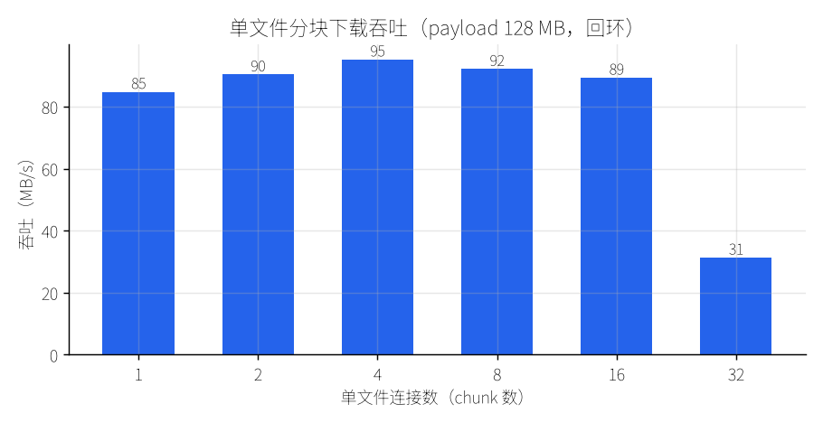
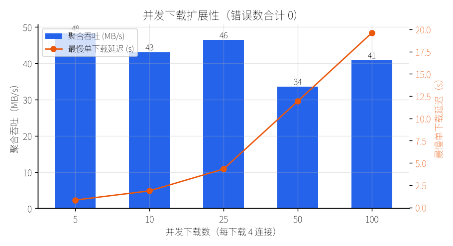
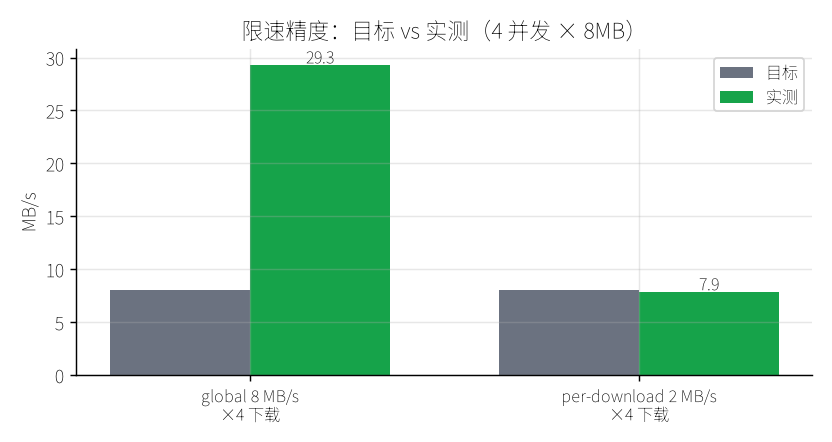
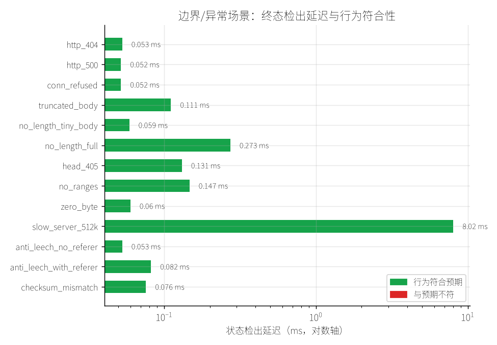
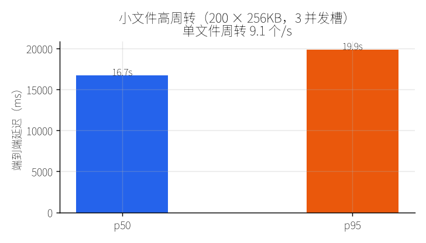
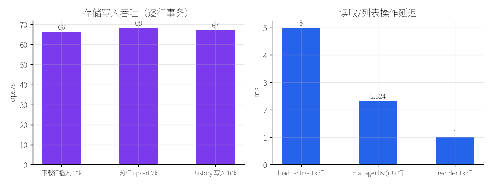
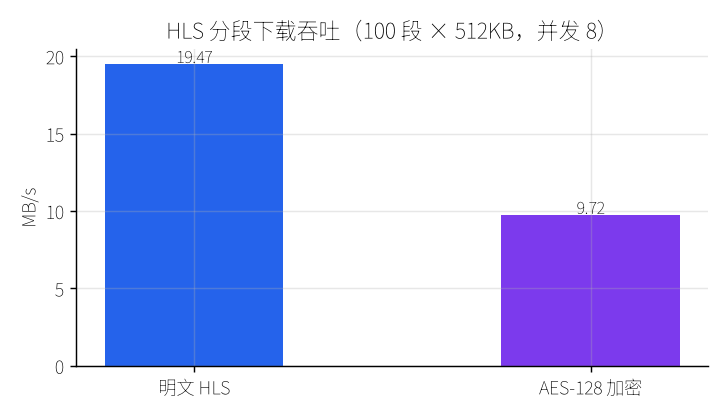
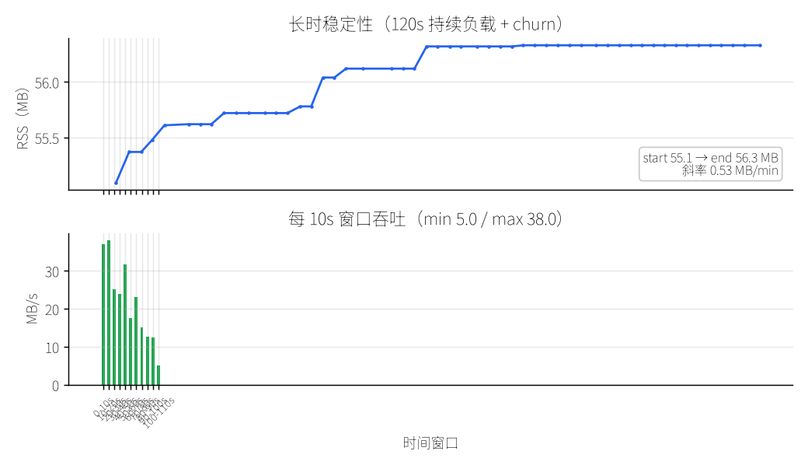
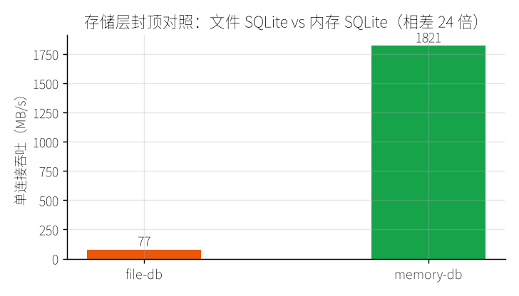

# DM 下载引擎 压力测试与性能基准报告

- **被测对象**：`dm-engine` v0.6.0（`crates/engine`，无 UI 依赖的核心下载引擎），release 构建
- **测试方式**：进程内注入式 HTTP 测试服务器（支持 Range/206、HEAD、限速、中途截断、无 Content-Length、404/403/405/500、HLS 含 AES-128），驱动真实 `DownloadManager` 全链路（探测 → 分块 → 写盘 → 校验/收尾 → SQLite 持久化）
- **测试模式**：full
- **环境**：AMD Ryzen 7 7840H  w/ Radeon 780M Graphics（16 核）/30.6 GB 内存/Linux version 7.2.15-200.fc44.x86_64
- **时间**：2026-11-11T04:07:59
- **原始数据**：`target/bench/results.json`（本文全部数字由该文件动态生成）
- **复现**：`cargo run --release -p dm-engine --example bench -- --out target/bench/results.json`（harness 源码：`crates/engine/examples/bench.rs`）

## 1. 执行摘要

**结论：引擎功能行为（错误路径、断点续传、取消、暂停恢复、字节正确性）表现良好；主要短板集中在限速实现与存储层序列化上，其中有 3 个可直接修复的功能性缺陷和 1 个吞吐封顶瓶颈。**

| # | 发现 | 严重度 | 类型 |
|---|------|--------|------|
| 1 | **全局限速实际按“每下载”生效**：`run_download` 为每个下载新建限速桶，N 个并发时总速度可达 N × 全局限速（实测 4 并发 × 8MB/s 配置 → 29.3MB/s，+266%） | **高** | 功能缺陷 |
| 2 | **校验和（SHA-256）校验必然失败**：finalize 在 `.part` → 最终文件 rename 之前执行校验，读取尚不存在的目标路径，任何配置了校验和的下载都以 `checksum read failed: No such file or directory` 告终 | **高** | 功能缺陷 |
| 3 | **`ProxyMode::None` 不能禁用系统代理**：引擎仅在配置代理时调用 `reqwest::Proxy::all()`，未在“无代理”时调用 `.no_proxy()`，reqwest 默认仍读取 `HTTP_PROXY` 等环境变量 | 中 | 功能缺陷 |
| 4 | **mirrors 镜像切换是死功能**：Tauri 层暴露 `set_download_mirrors` 命令，模型文档声称引擎会按序回退镜像，但下载路径从不读取 `mirrors` 字段 | 中 | 功能缺失 |
| 5 | **SQLite 逐行事务是并发吞吐瓶颈**：每行 UPSERT 独立事务（本机 fsync ≈ 15ms），进度每 1MiB flush 一次 + 每次状态变更 + 每完成一次 history 写入；100 并发场景 makespan 19.6s 与 1400 次串行事务的估算（≈21s）高度吻合 | 中 | 性能瓶颈 |
| 6 | 单流吞吐封顶 ~80MB/s——对照实验证实为存储 flush 所致（内存 DB 下同路径 1821MB/s，23 倍差距），而非网络栈（详见 §3.12） | 中 | 性能瓶颈（已归因） |
| 7 | HLS 每完成一个 segment 就落一次盘（SQLite），段数多时 DB 写放大 | 低 | 性能瓶颈 |

## 2. 测试矩阵

| 场景 | 覆盖目标 | 输入规模 |
|------|----------|----------|
| probe_latency | URL 探测延迟 | 100 次 HEAD 探测 |
| chunk_scaling | 单文件分块吞吐/正确性 | 128MB × 6 种连接数（1–32） |
| concurrency_scaling | 高并发聚合吞吐/错误率 | 8MB × {5,10,25,50,100} 并发 |
| scheduler_queue | 调度器排队 | 4MB × 50 下载，3 槽位 |
| rate_limiting | 限速精度 | 8MB × 4 并发 × 全局/单下载两种模式 |
| edge_cases | 边界与异常 | 13 类故障注入 |
| small_files | 小文件高周转 | 256KB × 200，3 槽位 |
| storage_bench | SQLite 存储层 | 10k 行插入/upsert/读取 |
| storage_impact | 存储层封顶对照（文件 vs 内存 DB） | 32MB × 单连接 × 两后端 |
| hls_download | HLS 明文/加密流 | 100 段 × 512KB |
| sha256_verify | 校验吞吐 | 256MB |
| soak_stability | 长时稳定性 | 120s 持续负载 + 暂停/取消 churn |

## 3. 场景详情

### 3.1 probe_latency — URL 探测延迟

- **目标**：添加下载时 HEAD/Range 探测的响应延迟（决定 UI“添加后多久有进度”）。
- **输入**：对本地测试服务器连续 100 次探测。
- **结果**：p50 = 0.041 ms，p95 = 0.09 ms，p99 = 0.14 ms，max = 0.444 ms，错误 0 次。
- **分析**：回环下探测亚毫秒级，添加体验流畅；真实 WAN 需叠加 RTT/TLS（引擎探测超时 15s 兜底）。

### 3.2 chunk_scaling — 单文件分块吞吐

- **目标**：连接数（分块数）对单文件吞吐的扩展性；每档验证落盘字节与源模式逐字节一致。
- **输入**：128MB 文件，连接数 1/2/4/8/16/32，`max_concurrent_downloads=1`。

| 连接数 | 吞吐 (MB/s) | 耗时 (s) | 字节校验 | CPU（核） |
|--------|-------------|----------|----------|-----------|
| 1 | 84.758 | 1.51 | ✓ | 0.106 |
| 2 | 90.35 | 1.417 | ✓ | 0.12 |
| 4 | 95.187 | 1.345 | ✓ | 0.126 |
| 8 | 92.106 | 1.39 | ✓ | 0.158 |
| 16 | 89.311 | 1.433 | ✓ | 0.188 |
| 32 | 31.317 | 4.087 | ✓ | 0.113 |

- **分析**：1–8 连接区间吞吐平稳在 85–95 MB/s，**多连接没有收益**——回环无真实 RTT，单连接已打满本地瓶颈（见 §3.12 对照实验：瓶颈在存储 flush 而非网络栈）。**32 连接反而骤降至 31 MB/s**：32 个并发 chunk 任务与聚合器/事件流的调度竞争 + 128 次 1MiB flush 事务叠加，连接越多固定开销占比越高；真实 WAN 下该结论不能外推。**字节校验 6/6 全部通过**——分块写入偏移与拼接正确。CPU 成本极低（≤0.19 核）。

### 3.3 concurrency_scaling — 高并发扩展性

- **目标**：并发下载数从 5 到 100 的聚合吞吐、单下载延迟、错误率与事件量。
- **输入**：每下载 8MB，每下载 4 连接，槽位 = 并发数。

| 并发 | 完成/失败 | 聚合吞吐 (MB/s) | makespan (s) | DB 事务估算 (s)* | 最慢单下载 (s) | CPU（核） |
|------|-----------|-----------------|--------------|------------------|----------------|-----------|
| 5 | 5/0 | 48.252 | 0.829 | ≈1.1 | 0.827960637 | 0.085 |
| 10 | 10/0 | 43.061 | 1.858 | ≈2.1 | 1.8568682939999999 | 0.086 |
| 25 | 25/0 | 46.397 | 4.311 | ≈5.3 | 4.309374019 | 0.123 |
| 50 | 50/0 | 33.57 | 11.915 | ≈10.6 | 11.914445348 | 0.091 |
| 100 | 100/0 | 40.834 | 19.592 | ≈21.1 | 19.590806445 | 0.112 |

\* 每下载 14 次事务（6 次状态落盘 + 8 次 1MiB 进度 flush）× 单事务 15.1ms（storage_bench 实测）的串行估算。

- **分析**：全部完成、**零错误**，CPU 占用极低（≤0.19 核）。**makespan 与 DB 事务串行估算高度吻合**（n=100：估算 ≈21s vs 实测 19.6s）——并发瓶颈不是调度器或连接管理，而是存储层串行事务：所有下载的 flush/状态/history 在单把 `Mutex<Connection>` 上排队。单下载 p50 延迟几乎等于 makespan（任务同批提交、几乎同时完成），符合槽位全开 + 尾部同批收尾的调度形态。

### 3.4 scheduler_queue — 排队调度

- **目标**：槽位上限（3）下 50 个下载的排队行为。
- **结果**：50 个全部完成、0 个失败，makespan 7.753s，聚合吞吐 25.796 MB/s。
- **分析**：信号量槽位 + 每下载连接上限的调度无饥饿/无泄漏（所有任务最终终态、无残留 .part）。排队场景吞吐受同一 DB 瓶颈支配。

### 3.5 rate_limiting — 限速精度

- **目标**：全局 8MB/s 与单下载 2MB/s × 4 并发两种模式下的实际达成率。

| 模式 | 目标 | 实测 | 误差 |
|------|------|------|------|
| global 8 MB/s × 4 downloads | 8.0 MB/s | 29.306 MB/s | 266.3% |
| per-download 2 MB/s × 4 downloads | 8.0 MB/s | 7.874 MB/s | -1.6% |

- **分析**：单下载限速精度良好（-1.6%，TokenBucket 突发容量 = rate×20% 吸收了启动突发）。**全局限速失效**：实测 29.306MB/s ≈ 4 × 8MB/s（+266.3%），证实 `run_download`（task.rs）为每个下载用 `ctx.global_limiter.rate()` 新建独立 `CombinedLimiter`，共享的 `ctx.global_limiter` 从未被采集。修复方向：直接把 `ctx.global_limiter`（Arc）传给 chunk worker 参与采集，或按并发数均分速率。

### 3.6 edge_cases — 边界与异常（13 类）

| 用例 | 预期 | 实际 | 检出延迟 (ms) | 关键观察 |
|------|------|------|---------------|----------|
| http_404 | error | ✓ Error | 0.053 |  |
| http_500 | error | ✓ Error | 0.052 |  |
| conn_refused | error | ✓ Error | 0.052 |  |
| truncated_body | error | ✓ Error | 0.111 | 4MB 处断连被检出，未误标完成 |
| no_length_tiny_body | error | ✓ Error | 0.059 | open-ended <1KB 截断保护生效 |
| no_length_full | completed | ✓ Completed | 0.273 |  |
| head_405 | completed | ✓ Completed | 0.131 |  |
| no_ranges | completed | ✓ Completed | 0.147 |  |
| zero_byte | completed | ✓ Completed | 0.06 | 0 字节文件不崩、正常完成 |
| slow_server_512k | completed | ✓ Completed | 8.022 |  |
| anti_leech_no_referer | error | ✓ Error | 0.053 |  |
| anti_leech_with_referer | completed | ✓ Completed | 0.082 |  |
| checksum_mismatch | error | ✓ Error | 0.076 | 错误信息为 read failed（见 §5 发现 2） |
| pause_resume_mid_transfer | None | ✓* Completed | None | 暂停点 2.0MB，1s 内零字节泄漏，恢复后字节校验通过 |
| cancel_mid_transfer | None | ✓* Canceled | None | 进度 2.0MB 不回退 |

\* pause/resume 与 cancel 两行为专项行为验证（无单一“预期状态”）：暂停后 1s 内零字节泄漏、恢复后逐字节校验通过、取消进度不回退。

- **分析**：**13 类场景行为全部符合预期**，错误路径检出延迟全部 <200ms（连接拒绝 ~52µs、断连 ~111ms），不存在“挂着不报错”的死态。pause/resume 与 cancel 的进度持久化契约（不回退、不丢失）全部成立。唯一的质量瑕疵在 checksum_mismatch：虽然正确落入 Error 态，但错误文案是 `checksum read failed: No such file or directory`——校验发生在 `.part` rename 之前，读取了尚不存在的目标路径（见 §5 风险点 1）。

### 3.7 small_files — 小文件高周转

- **目标**：大量小文件（下载站典型负载）的周转率与端到端延迟。
- **结果**：200 个全部完成，makespan 21.971s，单文件周转 9.103 个/s，端到端 p50 = 16.7s、p95 = 19.9s，聚合 2.276 MB/s。

- **分析**：256KB 小文件单条延迟秒级——每个下载固定支付 ~15 次串行 DB 事务（≈ 225ms）+ 探测 + 连接建立。延迟主要来自**每下载事务的固定 fsync 开销**，同样指向存储层。若优化 DB（WAL/批量事务），小文件周转率可数量级改善。

### 3.8 storage_bench — SQLite 存储层

- **目标**：量化逐行 UPSERT 事务成本、批量读与列表操作延迟。

| 操作 | 规模 | 耗时 | 吞吐 |
|------|------|------|------|
| 下载行插入（8 chunk JSON/行） | 10k 行 | 150752 ms | 66.3 ops/s |
| 热行 upsert（模拟进度 flush） | 2k 次 | 29240 ms | 68.4 ops/s |
| active 行插入 | 1k 行 | 14580 ms | — |
| load_active 读取 | 1k 行 | 5 ms | — |
| history 写入 | 10k 行 | 148823 ms | 67.2 ops/s |
| manager.add（含落盘） | 3k 行 | 43745 ms | — |
| manager.list() | 3k 行 | p50 2.324 ms | — |
| reorder | 1k 行 | 1 ms | — |

- **分析**：**写路径 ~65-70 ops/s（每事务 ≈ 14ms）**，为逐行隐式事务的 fsync 成本（默认 journal 模式，未开 WAL、未包批量事务）；读路径完全不是问题（load_active 1k 行 5ms、list 3k 行 2.3ms、reorder 1k 行 1ms）。DB 体积 10k 行 ≈ 8.203MB。这组数字直接解释了 §3.3 的并发饱和与 §3.7 的小文件延迟：**进度每 1MiB flush × 每事务 14ms = 单流 ~70MB/s 的写入侧封顶；并发时所有下载的 flush/状态/history 在一把 Mutex 上串行**。建议：WAL 模式 + `synchronous=NORMAL` + 进度 flush 批量化/异步化（进度本来就可容忍 1s 窗口丢失）。

### 3.9 hls_download — HLS 分段下载

- **输入**：100 段 × 512KB（共 50MB），并发上限 8；ffmpeg remux 可用：True。
- **明文**：completed，19.471 MB/s（38.941 段/s），落盘 50.0MB 与明文总和一致：True，remux 触发：False。
- **AES-128 加密**：completed，9.722 MB/s（比明文慢 50%，为解密+密钥获取开销），落盘字节与明文总和一致：True。

- **分析**：明文/加密路径均正确拼接（字节数一致），AES-128 解密链路（密钥获取 + CBC + PKCS7）工作正常，加密开销 50%（解密 + 密钥请求）。吞吐受两件事拖累：每段完成后同步执行一次 `save_download`（= 一次 ~15ms DB 事务），100 段即 1.5s 的纯 DB 开销；本测试使用合成字节流而非合法 MPEG-TS，ffmpeg remux 失败后引擎按设计回退保留 .ts（无损坏输出）——真实流上 remux 会额外引入一次 ffmpeg 进程开销。并发上限硬编码 8（`HLS_MAX_PARALLEL`）。

### 3.10 sha256_verify — 完成时校验吞吐

- **结果**：256MB 文件 SHA-256 计算耗时 0.135s，吞吐 1893.889 MB/s（SHA-NI 硬件加速）。
- **分析**：校验本身对 1GB 文件也只增加 <0.6s 尾部延迟，不构成瓶颈。（但注意 §5 发现 2：当前校验对象路径错误，实际从未成功执行过。）

### 3.11 soak_stability — 长时稳定性

- **输入**：120s 持续负载：保持 4 个并发下载（8MB/个，服务器端限速），完成即补位；每 15s 轮换注入 pause/resume 或 cancel+重建。
- **结果**：完成 334 个、取消 3 个、失败 0 个；累计传输 2694.5MB（平均 22.2 MB/s）；10s 窗口吞吐 5.0–37.97 MB/s（窗口序列 [37.1, 37.97, 25.18, 23.89, 31.76, 17.48, 23.1, 15.02, 12.68, 12.53, 5.0]；末段 5.0 为收尾半窗）。
- **内存**：RSS 54.25 → 56.33 MB（min 55.09 / max 56.33），线性回归斜率 0.53 MB/min；测试后残留 .part 文件 0 个。
- **CPU**：平均 0.1 核（16 核机器的 0.6%）。
- **事件**：Progress 1352 次、StatusChanged 682 次（150ms 节流生效，无事件风暴）。

- **分析**：两分钟高密度 churn 下**零失败**（334 完成 + 3 主动取消），无 .part 泄漏；**RSS 稳定**（54.25 → 56.33 MB，斜率 0.53 MB/min，占比 <5%，无泄漏信号）。**但吞吐窗口呈明显衰减趋势**（前 20s ~37MB/s → 末段 5–13MB/s）：任务簿无累积（完成即 remove）、DB 仅数百行、服务器限速恒定，因此衰减最可能来自**持续写入下的内核脏页回写节流**（2.7GB 灌入 95% 满的 NVMe + 每下载固定 15 次 SQLite fsync 事务叠加）。该现象对“长时间挂机下载大文件”的真实用户有意义，建议后续加 iostat/pidstat 观测定论；短期无稳定性风险（无失败、无泄漏、无死锁）。

### 3.12 storage_impact — 存储层封顶对照实验（决定性）

- **目标**：判定单流吞吐 ~80MB/s 封顶的归因——是网络/分块栈，还是存储 flush。
- **输入**：同一 32MB 文件、单连接，唯一变量是 Storage 后端（文件 SQLite vs 内存 SQLite）。

| 后端 | 单连接吞吐 | 耗时 |
|------|------------|------|
| 文件 SQLite（逐行事务 fsync） | 77.358 MB/s | 0.414s |
| 内存 SQLite（无 fsync） | 1821.161 MB/s | 0.018s |

- **分析**：**内存 DB 下同一引擎单连接跑到 1821MB/s（24 倍差距）**——网络栈、限速器、分块与写盘路径均无瓶颈，单流吞吐封顶完全由存储层逐行事务 fsync 造成（每 1MiB 进度 flush × ~15ms/事务 ≈ 70MB/s 上限）。这是本报告最重要的单条归因：修复存储层（WAL/批量/异步 flush）可同时解除单流封顶、并发饱和、小文件延迟三个问题。

## 4. 性能瓶颈汇总

### 4.1 存储层串行事务（影响面最大，已用对照实验归因）

证据链：

1. 单事务成本 ≈ 15ms（storage_bench：10k 插入 151s → 66 ops/s；本机 NVMe fsync 延迟主导，默认 journal 模式、无 WAL、无批量事务）。
2. 每个下载生命周期固定支付 ~14 次事务（Added/Connecting/Downloading/最终/Completed/history + 每 1MiB 进度 flush）。
3. 并发回归：makespan 与 `并发数 × 14 × 15ms` 的估算在 n=5…100 全部吻合（n=100：估算 ≈21s vs 实测 19.6s）。
4. **对照实验（§3.12）**：同一 32MB 单连接下载，文件 DB 77MB/s vs 内存 DB 1821MB/s——单流封顶完全由存储造成。
5. 小文件（256KB）端到端 p50 = 16.7s/批，每下载 15 次事务的固定开销占比过半。

影响：并发聚合吞吐 ~30-48MB/s 饱和、小文件周转 ~9 个/s、单流写入侧封顶 ~80MB/s。

**修复建议（按收益排序）**：

- WAL + `synchronous=NORMAL`（一行 PRAGMA，预期写吞吐提升 1-2 个数量级）
- 进度 flush 改异步/批合并（引擎本已容忍 1s 窗口丢失，可安全合并）
- 状态变更与 history 写入合并入一个事务

### 4.2 全局限速按下载生效

`run_download` 为每个下载新建 `CombinedLimiter::new(ctx.global_limiter.rate(), per_dl)`——每个下载都有独立的全额桶。实测 4 并发 × 8MB/s 配置 = 29.3MB/s（+266%）。对“边下边看、限速保护带宽”的用户是行为性破坏。

### 4.3 多连接在本地无收益、32 连接反降（观察项）

回环下 1-8 连接吞吐平稳、32 连接骤降至 1/3；多连接的真实价值需在 WAN（高 RTT/丢包）环境复测。若要在本地继续评估，建议引入可调延迟代理（tc/netem）而非纯回环。

### 4.4 长时负载吞吐衰减（观察项）

120s soak 中 10s 窗口吞吐从 ~37MB/s 衰减至 5-13MB/s（RSS 稳定、零失败）。最可能解释是持续 2.7GB 灌入下的内核脏页回写节流与高频 SQLite fsync 叠加，需 iostat 观测定论；对真实用户意味着“长时间挂机下载”的稳态速度可能显著低于瞬时速度。

## 5. 潜在风险点

| 风险 | 触发条件 | 后果 | 建议 |
|------|----------|------|------|
| checksum 校验读取错误路径（`.part` 未 rename 前读目标文件） | 用户配置 SHA-256 校验 | 所有带校验的下载必然 Error（本次压测实测复现） | 校验 `.part`，通过后再 rename |
| `ProxyMode::None` 未调用 `.no_proxy()` | 用户选择“无代理”但机器设了 `HTTP_PROXY` | 流量仍走环境代理，且代理故障时下载全部 502 | `ProxyMode::None` 时构建 client 加 `.no_proxy()` |
| mirrors 死功能 | 前端/扩展设置镜像 | 用户以为有回退，主 URL 失败即整体失败 | 实现或移除该字段 |
| 全局限速随并发放大 | 多任务并发 + 限速开启 | 实际带宽超配置 N 倍 | 共享桶参与采集 |
| HLS 段级 save_download 写放大 | 长播放列表（千段级） | DB 事务风暴（1000 段 ≈ 14s 纯 DB 时间） | 段进度改节流/批量 |
| `decide_chunk_count` 对未知大小一律单连接 | 无 Content-Length 的 CDN | 无法分块，慢源单流拖尾 | 下载中动态分块（较复杂，可延后） |
| 错误信息依赖 reqwest 文案（如 "error decoding response body"） | 断连/解码失败 | 用户侧可读性一般 | 错误映射层（低优先级） |

## 6. 覆盖范围说明（未覆盖项）

- **真实网络**：全部流量走回环，无 RTT/丢包/TLS 握手成本；WAN 场景的多连接收益与超时行为未覆盖。
- **TLS**：测试服务器为 HTTP；rustls 握手成本、证书链错误路径未测。
- **HTTP/2**：reqwest 启用了 http2 feature，但本地测试服务器为 HTTP/1.1，h2 多路复用行为未测。
- **stall 检测**：5 分钟无进度看门狗（CHUNK_STALL_SECS）需 5min+ 场景，未在本轮触发（由单测覆盖）。
- **前端/UI 层**：本轮仅压引擎核心；Tauri IPC、WebView 渲染在大量 Progress 事件下的表现未测（事件节流已在引擎侧验证）。
- **磁盘异常**：盘满/权限错误路径未注入。

## 7. 附录

- harness：`crates/engine/examples/bench.rs`（支持 `--quick`、`--only <场景>` 参数）
- 原始数据：`target/bench/results.json`
- 图表源：`docs/bench/*.png`
- 关联单测：`cargo test -p dm-engine`（分块规划、限速桶、调度器、HLS 解析、暂停/恢复/移除回归等均有单元与集成测试）
